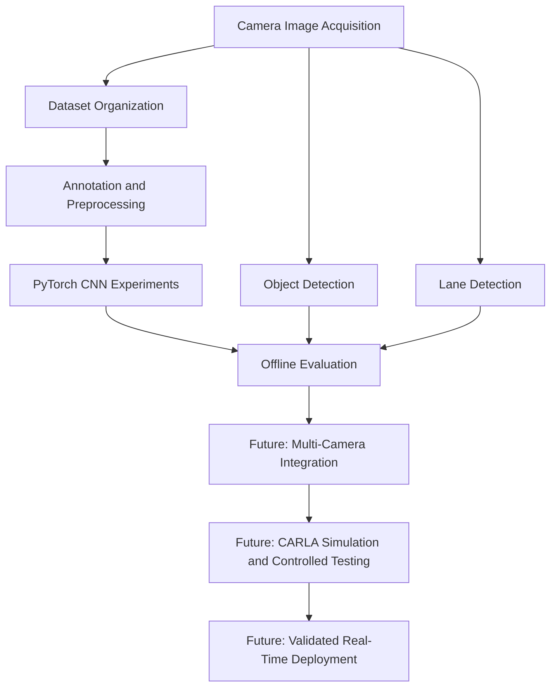

# The prototype :


# Autonomous Driving Prototype: Camera-Based Perception with Deep Learning

[](LICENSE)
[](https://www.python.org/)
[](https://pytorch.org/)

An experimental autonomous-driving project exploring how **computer vision, convolutional neural networks (CNNs), and multi-camera perception** can support environmental understanding and reduce dependence on expensive sensing hardware.

The project combines a physical prototype, image acquisition, dataset annotation, PyTorch model experiments, object detection, and lane detection. It investigates the potential of vision-based perception as part of a broader autonomous-driving architecture.

> **Project status:** Research and development prototype. The components in this repository are experimental and have not been demonstrated as a fully integrated, safety-validated autonomous-driving system.

---

## Table of Contents

- [Overview](#overview)
- [Research Objectives](#research-objectives)
- [Prototype Gallery](#prototype-gallery)
- [System Architecture](#system-architecture)
- [Technical Approach](#technical-approach)
- [Camera-Based Perception vs. LiDAR](#camera-based-perception-vs-lidar)
- [Object Detection Demonstration](#object-detection-demonstration)
- [Dataset Collection and Annotation](#dataset-collection-and-annotation)
- [Repository Structure](#repository-structure)
- [Installation](#installation)
- [Running the Experiments](#running-the-experiments)
- [Evaluation and Performance](#evaluation-and-performance)
- [Current Limitations](#current-limitations)
- [Roadmap](#roadmap)
- [Safety Notice](#safety-notice)
- [Contributing](#contributing)
- [License](#license)

---

## Overview

Autonomous driving requires a vehicle to perceive its surroundings, identify relevant objects, understand the road, and make appropriate driving decisions under changing environmental conditions.

Traditional autonomous-driving architectures frequently use combinations of cameras, LiDAR, radar, ultrasonic sensors, and other vehicle sensors. Although these systems can provide complementary information, additional hardware introduces costs associated with components, integration, calibration, maintenance, and processing.

This project explores a complementary research question:

**How much useful environmental information can a vision-based system extract from camera images, and under what conditions could this reduce reliance on more expensive sensing hardware?**

The prototype investigates several components of a potential perception pipeline:

- **Multi-camera perception:** Exploring image acquisition from multiple camera viewpoints, with an eight-camera configuration represented in the experimental code.
- **Deep learning:** Developing convolutional neural network experiments using PyTorch.
- **Object detection:** Exploring visual identification of objects in driving environments.
- **Lane detection:** Investigating road-lane identification from images.
- **Dataset development:** Capturing, organizing, preprocessing, and annotating visual data.
- **Simulation and tracking:** Identifying potential extensions for systematic evaluation in simulated driving environments and across video frames.

These components form the foundation for further research into efficient, camera-centric autonomous-driving systems. Their combination into a reliable, real-time vehicle-control architecture remains future work.

## Research Objectives

The project is guided by five principal objectives.

### 1. Investigate camera-based environmental perception

Explore how camera images can represent the surrounding driving environment and provide useful information for downstream perception tasks.

### 2. Experiment with convolutional neural networks

Investigate CNN architectures and image-processing pipelines using PyTorch, including the extraction of spatial features from RGB images.

### 3. Explore multi-camera configurations

Investigate how different camera viewpoints could improve environmental coverage and support perception when a single camera has a restricted field of view.

### 4. Evaluate sensing and computational trade-offs

Establish a framework for comparing camera-based approaches with alternative sensing configurations, taking into account accuracy, latency, hardware requirements, and failure conditions.

### 5. Work toward efficient real-time perception

Explore the computational requirements of processing visual information at driving-relevant frame rates while retaining sufficient perception quality.

---

## Prototype Gallery

The following images document the physical prototype and the early development of the project.

### Physical prototype


### Prototype and system visuals


---

## System Architecture

The intended workflow connects visual data acquisition with model development, perception experiments, and evaluation.



*This diagram represents the intended experimental workflow. The repository's scripts and notebooks are separate development components; the diagram does not imply that the full pipeline is already integrated.*

### 1. Image acquisition

Collect images from a camera or camera-equipped prototype. For multi-camera experiments, organize images by camera viewpoint and maintain consistent frame indexing where synchronized inputs are required.

### 2. Dataset preparation

Organize the collected images and apply appropriate preprocessing. Depending on the task, this may include resizing, normalization, annotation, and dataset splitting.

### 3. Neural network development

Use PyTorch to construct and train experimental CNN architectures. Different architectures serve different purposes, such as image reconstruction or learning features for downstream perception tasks.

### 4. Visual perception

Explore object detection and lane detection through the corresponding notebooks.

### 5. Evaluation

Assess the components individually before attempting to combine them. Evaluation should include task-specific accuracy, inference latency, robustness, and computational requirements.

### 6. Integration and deployment

Multi-camera fusion, driving-policy integration, simulation-based validation, and real-vehicle deployment are subsequent engineering stages rather than established capabilities of the current repository.

---

## Technical Approach

### Convolutional neural networks

CNNs are widely used in computer vision because they learn spatial features directly from image data. Early convolutional layers can identify local patterns, while deeper layers can learn more complex visual representations.

A typical CNN workflow involves:

1. Loading and preprocessing image data.
2. Passing image tensors through convolutional layers.
3. Applying nonlinear activation functions and spatial downsampling.
4. Producing task-specific outputs.
5. Computing a suitable objective or loss function.
6. Updating model parameters through backpropagation and optimization.
7. Evaluating the trained model on data that was not used for training.

The exact objective depends on the task. For example, an image-reconstruction model requires a different training objective from an object detector or a steering-angle predictor.

**In this repository, `Pytorch_CNN.py` contains a convolutional autoencoder experiment for image reconstruction.** It should not be interpreted as a complete steering-control model. The multi-camera implementation is an additional experimental architecture that requires further validation and completion of its training logic.

### Image preprocessing

The preprocessing pipeline may include:

- Conversion to RGB.
- Resizing images to a consistent input resolution.
- Conversion to PyTorch tensors.
- Normalization.
- Appropriate augmentation during training.

Preprocessing choices should match the assumptions of the selected model. For example, the normalization applied during inference must be consistent with that used during training.

### Training and validation

A reliable experimental workflow should separate training data from validation and test data. When images originate from consecutive video frames, splitting should be performed carefully to avoid near-identical frames leaking across the training and test sets.

The current code includes experimental training and validation logic, but reproducibility and task-specific evaluation should be strengthened before interpreting the models as reliable autonomous-driving components.

---

## Camera-Based Perception vs. LiDAR

One central research motivation is to investigate whether camera-based perception can reduce the cost and complexity of some autonomous-driving sensor configurations.

### Why explore camera-based systems?

- **Cost:** Cameras can offer a comparatively accessible route to collecting rich environmental data.
- **Visual information:** RGB images provide appearance, texture, colour, and semantic cues.
- **Scalability:** Multiple cameras can be positioned to cover different regions around a vehicle.
- **Deep learning:** Modern computer-vision techniques can extract useful representations from high-dimensional visual data.

### Why not assume LiDAR can simply be removed?

Cameras and LiDAR provide different types of information. Camera-only systems can struggle with ambiguous depth, poor lighting, glare, adverse weather, occlusion, and unfamiliar environments. LiDAR provides geometric distance measurements that can complement visual perception, although LiDAR systems also have hardware, environmental, and processing limitations.

Consequently, camera-based perception should be evaluated against suitable baselines rather than assumed to be a universal replacement for LiDAR.

A rigorous comparison should examine:

| Evaluation dimension | What to investigate |
|---|---|
| Perception quality | Detection performance, missed objects, and false positives |
| Depth and spatial understanding | Whether reliable distance and geometry estimates are available |
| Environmental robustness | Performance in darkness, glare, rain, and partial occlusion |
| Computational efficiency | Inference latency, throughput, and hardware utilisation |
| System cost | Sensors, computing hardware, calibration, integration, and maintenance |
| Operational safety | Failure detection, redundancy, fallback behaviour, and safe stopping |

**The research objective is to measure trade-offs, not to claim that one sensor configuration is universally superior.** The current repository does not establish that removing LiDAR is safe, more accurate, or cheaper in a complete autonomous-driving system.

### Multi-camera concept

The project includes an eight-camera CNN experiment intended to investigate multi-view image inputs.

The experimental code contains placeholders for the individual camera directories, so the configuration needs to be adapted to the actual dataset. A complete implementation would also require validated input dimensions, appropriate target labels and loss calculations, and systematic testing of the multi-camera training pipeline.

The original project concept considered processing approximately 33 frames per second. This is a **design target to investigate, not a verified performance result** in this repository. Any benchmark should define whether that rate refers to each camera or the aggregate processing pipeline.

---

## Object Detection Demonstration

Object detection is an important perception task in autonomous driving. It involves locating relevant objects within an image and, depending on the model, assigning class labels and confidence scores to the detected regions.

Potential applications include identifying vehicles, pedestrians, road signs, and other road users.

The repository includes an object-detection notebook and a demonstration video.

**[Watch the object-detection demonstration on YouTube](https://youtu.be/1xrBWL5Kkog)**

### Example visual output


Object-detection performance should ultimately be evaluated using a labelled test set and metrics appropriate to the task, rather than visual demonstrations alone.

---

## Lane Detection

Lane detection aims to identify lane markings and estimate their position or geometry relative to the vehicle.

Reliable lane perception can support road-boundary understanding and downstream driving decisions. In practice, the task can be affected by faded markings, shadows, road repairs, curves, occlusion, and changes in illumination.

The repository contains a dedicated notebook for lane-detection experiments.


Further development should assess performance across different road conditions and quantify errors instead of relying exclusively on visual inspection.

---

## Dataset Collection and Annotation

Model quality depends heavily on the quality, diversity, and consistency of the training data.

### Data collection

The repository includes `collecting_datasets.py`, an OpenCV-based camera-capture utility. Before using it, review the capture count, camera configuration, and output directory to ensure they match your intended experiment.

Data collection should ideally cover different:

- Camera positions and viewing angles.
- Road layouts and lane configurations.
- Lighting conditions and weather.
- Object distances, orientations, and occlusions.
- Relevant traffic scenes and uncommon scenarios.

### Data annotation

The project uses **[LabelImg](https://github.com/HumanSignal/labelImg)** for image annotation.


Additional annotation examples:


Annotation labels must match the expected format of the model or notebook being used. For detection tasks, annotation quality and consistency directly affect training and evaluation.

### Dataset preparation recommendations

For more reproducible experiments:

1. Keep raw and processed datasets separate.
2. Preserve original images and annotation files.
3. Record camera identifiers, timestamps, and relevant capture conditions.
4. Split training, validation, and test sets without leakage between closely related video frames.
5. Track dataset versions and document preprocessing parameters.
6. Keep test data separate until the final evaluation.

---

## Repository Structure

The following files are available in the repository:

| File | Purpose |
|---|---|
| `CNNs_8Camera.py` | Experimental eight-camera dataset handling and CNN architecture |
| `Pytorch_CNN.py` | PyTorch convolutional autoencoder experiment for image reconstruction |
| `collecting_datasets.py` | Camera-image capture utility using OpenCV |
| `object_detection.ipynb` | Notebook for object-detection experiments |
| `lane_detection.ipynb` | Notebook for lane-detection experiments |
| `get_path.ipynb` | Notebook for inspecting or working with image paths |
| `Test_annotation1.txt` | Sample annotation data |
| `classes.txt` | Class-label definitions |
| `.gitignore` | Git ignore configuration |
| `LICENSE` | Project licence |

The repository does not currently provide a complete, pinned dependency specification or a documented one-command pipeline for all experiments. Some scripts contain placeholder data paths and require configuration before execution.

---

## Installation

### Prerequisites

- Python 3.10, as referenced in the existing CNN script.
- Git.
- PyTorch and torchvision.
- A camera, if collecting new images.
- An NVIDIA GPU with a compatible PyTorch/CUDA installation for the training code as currently written, which uses `.cuda()`.

The notebooks and utilities may require additional packages depending on the specific experiment.

### 1. Clone the repository

```bash
git clone https://github.com/valid999/Autonomous_system.git
cd Autonomous_system
```

### 2. Create a virtual environment

```bash
python -m venv .venv
```

Activate it on Windows PowerShell:

```powershell
.\.venv\Scripts\Activate.ps1
```

Or on macOS/Linux:

```bash
source .venv/bin/activate
```

### 3. Install the core dependencies

```bash
python -m pip install --upgrade pip
python -m pip install torch torchvision numpy pillow opencv-python matplotlib jupyter
```

For annotation with LabelImg:

```bash
python -m pip install labelImg
```

For GPU training, install a PyTorch build compatible with your hardware and CUDA environment. Use the official [PyTorch installation selector](https://pytorch.org/get-started/locally/) to select the appropriate command.

> **Important:** These are baseline environment instructions, not a verified lockfile. The repository does not currently contain a `requirements.txt`, and the scripts may require additional configuration or code changes before they run successfully.

---

## Running the Experiments

### Launch the notebooks

From the repository root, start Jupyter:

```bash
jupyter notebook
```

Open the relevant notebook in your browser:

- `object_detection.ipynb` for object-detection experiments.
- `lane_detection.ipynb` for lane-detection experiments.
- `get_path.ipynb` for image-path exploration.

Review the notebook configuration and install any additional dependencies before executing its cells.

### Configure the image datasets

Before running the CNN scripts, update placeholder directory paths to point to your actual datasets.

For `Pytorch_CNN.py`, the image directory is represented by a placeholder similar to:

```python
img_dir = "path_to_images"
```

For `CNNs_8Camera.py`, the camera-directory configuration uses placeholders for the individual camera inputs. The dataset loader expects corresponding images to follow a naming convention such as `image_0.jpg`, `image_1.jpg`, and so on in each camera directory.

Ensure that directory names, image ordering, input shapes, and camera indexing are consistent with the code.

### Review the training code

The current CNN scripts are experimental. In particular, the eight-camera script requires further work and validation of its training logic before it can produce interpretable model-performance results. Do not assume that a script is ready for training or deployment merely because its dependencies have been installed.

For future iterations, it would be beneficial to add:

- A configurable dataset root.
- Device selection using `torch.device`.
- Explicit training targets and a suitable loss function for supervised tasks.
- Reproducible train/validation/test splits.
- Saved training configurations and model checkpoints.
- Documented inference commands and verified example outputs.

---

## Evaluation and Performance

A credible autonomous-driving experiment requires quantitative evaluation alongside visual examples.

The metrics should match the task being evaluated.

| Component | Suggested evaluation metrics |
|---|---|
| Object detection | Precision, recall, mean Average Precision (mAP), false-positive rate |
| Lane detection | Intersection over Union (IoU), F1 score, lane-position error |
| Image reconstruction | Mean Squared Error (MSE), Mean Absolute Error (MAE) |
| Real-time inference | Frames per second (FPS), latency, dropped frames |
| Multi-camera processing | Throughput, camera synchronisation, per-view performance |
| Robustness | Performance across lighting, weather, occlusion, and unfamiliar scenes |

### Real-time processing target

The initial concept considers processing visual input at approximately 33 FPS. A meaningful benchmark should report the hardware, image resolution, number of cameras, batch size, precision mode, and timing methodology.

It should also distinguish between:

- **Throughput:** How many frames the system processes per second.
- **Latency:** How long it takes to process an individual frame and deliver an output.
- **End-to-end delay:** The time from image capture to the availability of a usable perception or control output.

The repository does not currently provide a documented, reproducible benchmark establishing that the full system reaches this target. Performance figures should be added only after they have been measured.

---

## Current Limitations

This project is a prototype intended for experimentation and learning. Important limitations include:

- **Experimental implementations:** The available scripts and notebooks do not constitute a single integrated autonomous-driving stack.
- **Dataset configuration:** Some paths are placeholders and must be updated for the user's environment.
- **Training completeness:** The eight-camera training implementation needs further validation and completion before meaningful performance claims can be made.
- **Reproducibility:** Dependencies, hardware configurations, random seeds, and training settings are not yet fully documented in a unified environment specification.
- **Evaluation:** The repository does not currently provide a complete set of reproducible metrics proving autonomous-driving performance.
- **Sensor substitution:** No evidence in the repository establishes that camera-only perception can safely replace LiDAR or other sensors.
- **Deployment:** A trained image model alone does not provide a complete vehicle-control system, safety architecture, or fail-safe mechanism.

These limitations define the work required to progress from an experimental prototype toward a reproducible research implementation.

---

## Roadmap

The following are potential next steps for extending the project.

- [ ] Replace placeholder paths with a documented, configurable dataset structure.
- [ ] Add a pinned `requirements.txt` or equivalent environment file.
- [ ] Complete and validate the multi-camera training pipeline.
- [ ] Document dataset formats, annotation conventions, and class mappings.
- [ ] Add reproducible train, validation, and test workflows.
- [ ] Save model checkpoints, training histories, and evaluation results.
- [ ] Benchmark throughput and end-to-end latency on specified hardware.
- [ ] Evaluate camera-only and sensor-fusion approaches under controlled conditions.
- [ ] Expand testing across lighting, weather, occlusion, and unfamiliar scenes.
- [ ] Develop an object-tracking component for temporally consistent detections.
- [ ] Establish a CARLA simulation workflow and document the scenarios evaluated.
- [ ] Investigate inference optimisation and edge-device deployment.
- [ ] Integrate perception outputs with a driving policy only after appropriate validation.
- [ ] Document fail-safe behaviour and a safety-validation process before any real-vehicle testing.

---

## Safety Notice

This repository is intended for **research, education, and controlled experimentation**. It is not a certified or production-ready autonomous-driving system.

The models and scripts have not been established as safe for controlling a real vehicle. Do not connect experimental outputs directly to a vehicle's steering, acceleration, or braking systems without independent validation, appropriate supervision, redundant safeguards, and a comprehensive safety-engineering process.

Simulation results, if obtained in future work, should not be treated as proof of safe real-world operation.

---

## Contributing

Contributions that improve the reliability, reproducibility, and technical quality of the project are welcome.

Useful areas include dataset tooling, model implementation, annotation workflows, testing, inference optimisation, simulation, and documentation.

For substantial changes, open an issue to describe the proposed improvement before submitting a pull request. Include reproducible steps, configuration details, and evaluation results wherever possible.

---

## License

This project is distributed under the MIT License. See [`LICENSE`](LICENSE) for the applicable terms.

---

## Acknowledgements

This project brings together practical experimentation in robotics, computer vision, deep learning, and autonomous-driving perception. It reflects an ongoing effort to understand how visual intelligence can be developed, evaluated, and eventually integrated into more efficient autonomous systems.

**Repository:** [github.com/valid999/Autonomous_system](https://github.com/valid999/Autonomous_system)


## Additional information for Trial and Error
# Why do we need to neglact the Lidar 
We do need to eliminate the LIDAR because of the misinterpretations


# Data annotation with Labelimg 


# 1. Data collection 
Data Collection: The system captures real-time data from cameras mounted on the vehicle maybe the number of these cameras will be 8 camera. These cameras provide a continuous stream of images representing the vehicle's environment.
Data Preprocessing: The captured images are preprocessed to enhance features and reduce noise. Techniques such as normalization, resizing, and augmentation (flipping, rotation, etc.) are applied to improve the robustness of the CNN model , the main technique we are using right now is a technique related to the  PyTorch library will done everything behind the seen in terms of the resizing and shaping of the data we need to dataset with annotation.
Model Architecture : A CNN model is designed with multiple convolutional layers to extract spatial features from images. This model includes layers for convolution, pooling, and fully connected operations, which enable the extraction of hierarchical features from raw pixel data , there is also a flaaten layer that will give us to take the data from the normal layers into the fully connected layers we can say the flatten layer stack the data from the CNN into fully connected layer and I will mention it by details.
Training : The CNN model is trained on a labeled dataset, where each image is associated with a corresponding s teering angle or driving command. The training process involves backpropagation and optimization algorithms (e.g., Adam) to minimize the error between the predicted and actual driving commands , the training will quite difficult because of the GPU  and also base don the number of the dataset , The backpropagation stage is done by the PyTorch even the setting the gradient to zero.
Testing and Validation : The trained model is validated using a separate dataset to evaluate its performance in real-world scenarios. Metrics such as accuracy, precision, recall, and mean squared error are used to assess the model's effectiveness.
Deployment : The validated model is deployed in a self-driving car system ,  where it processes live camera feeds to make real-time driving decisions .
Some  benefits:
Enhanced Safety : Self--driving cars can reduce human errors , which is a leading cause of traffic accidents . CNNs enable these vehicles to accurately interpret and respond to complex visual stimuli , enhancing overall road safety .
Increased Efficiency : Autonomous vehicles can optimize driving patterns and reduce traffic congestion by communicating with each other and adjusting their routes in real-time.
Accessibility : Self--driving technologys can provide mobility solutions for individuals who are unable to drive, such as the elderly or disabled ,thereby increasing their independence and quality of life .
Environmental Impact : Autonomous vehicles can contribute to reduced emissions by optimizing driving efficiency and supporting the integration of electric vehicles.


# 2. Build & Traine the neural nedtwork


# 3. Object detection using the neural network(CNN).

https://youtu.be/1xrBWL5Kkog


# 4. Lane detection


# 5. CARLA SIMULATION


# 6. Object tracking 

Object tracking is an application of deep learning where the program takes an initial set of object detections develops a unique identification for each of the initial detections and then tracks the detected objects as they move around frames in a video.
